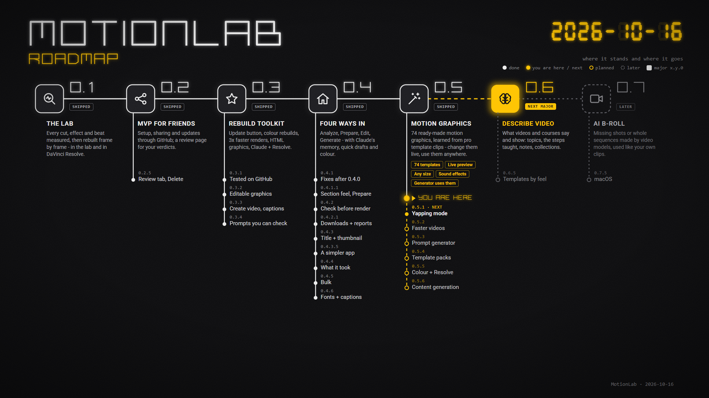

# MotionLab

**A local lab that takes apart the editing of any video - every cut, flash, zoom, speed ramp, split screen, text
pop and transition, frame-accurately - so you can learn its style and pacing and rebuild it with your own footage.**

> **Status: v0.5.2 - New edit, step by step** ([what's new](CHANGELOG.md) · [en español](CHANGELOG.es.md)) - Phase 2,
> the path from 0.5.0 to 1.0.0: New edit as six simple steps (clips, text, references, style with a colour palette,
> sound, final), the app in English or Spanish, analyses in about half the time, a one-file install, one way to
> review everything. **Analyse** videos you like (several at once, by focus: content creation, cinematic or both -
> colour grading included), a channel's thumbnails and scripts & prompts, **Prepare** a script, a title and a
> thumbnail, **Edit** your clips like up to three of them or the way you say (a quick draft in minutes, then Claude
> makes it great), **Generate** a video from zero (a motion-graphics video, or every prompt for AI video tools),
> **Motion Graphics** - 189 ready-made animated graphics (titles, lower thirds, transitions, charts, call-outs, end
> screens...) you change live and put in any video - and **Claude's memory**: everything it learned, in one place,
> used when it edits or generates for you. Since 0.3: colour rebuilds, 3x faster renders,
> graphics written as HTML, Claude Code connected to the lab and to DaVinci Resolve, updates that only offer versions
> GitHub's automatic tests passed.
> Detection was tuned on music videos; other categories work and get better with every verdict you give.

## Contents

- [What it is](#what-it-is)
- [What it does](#what-it-does)
- [Install (Windows 10 / 11) - 3 steps](#install-windows-10--11---3-steps) · [Instalar en 3 pasos (español)](#instalar-en-3-pasos)
- [First steps](#first-steps)
- [Editing your footage like a video you liked](#editing-your-footage-like-a-video-you-liked)
- [Claude Code in MotionLab](#claude-code-in-motionlab)
- [Updates](#updates)
- [Sharing knowledge - how it works](#sharing-knowledge---how-it-works)
- [Folders](#folders)
- [What comes next](#what-comes-next)
- [License](#license)

## What it is

Give it a reference - a music video, an Instagram reel, a cooking short, a tutorial, an ad, a motion-graphics piece,
a documentary. MotionLab measures every frame, finds the edits and effects, and shows them in a window where you scrub
frame by frame and read how each effect was made and how to rebuild it.
[Claude Code](https://claude.com/claude-code) looks at every effect and names it properly; you mark each one
Correct / Partly / Wrong, and the lab turns your corrections into rules.

**Built for a group of friends:** everyone runs MotionLab on their own PC with their own Claude plan and footage,
and what each install learns - reference cards with pacing and effects, and the rules from your feedback - is shared
through this GitHub repo. Analyse 10 videos each and everyone's MotionLab knows all 30.

*The roadmap moves in the app (Home), in the app's language. Its data is
[docs/roadmap/roadmap.json](docs/roadmap/roadmap.json): the big badges are the major versions (x.y.0), the smaller
versions hang below them, and the brackets above the line are the phases - Phase 2 is the path from 0.5.0 to 1.0.0.*

## What it does

- **Download** a reference from a link (YouTube, Vimeo, TikTok, Instagram ... via yt-dlp: MP4 up to 1080p, best
  quality, or MP3) - or drop a video into `refs\`. Only download and analyse videos you are allowed to use.
- **Categorise** it: music video, ad, motion graphics, documentary, vlog, tutorial, cooking, podcast, gaming, sports,
  travel, fashion, comedy, trailer, fan edit, other - plus your own tags. The format (vertical / horizontal, length)
  is measured.
- **Analyse** it: cuts and 30+ effect types with exact frame ranges (frame number + timecode on everything), beats
  and drops, **pacing** (cuts per minute, shot lengths, cuts in the first 3 seconds, cuts on the beat), contact sheets
  and previews per effect, "possible misses".
- **Analyse more than videos**: the Analyser has three ways in - videos cut by cut, a channel's thumbnails (their
  patterns, the font measured), and scripts & prompts (up to 20 at once, every quote Claude makes checked against the
  text).
- **Review** with Claude Code: what happens, timing and easing, camera or post, and how to rebuild it.
- **Teach it**: your verdicts in the app (Correct / Partly / Wrong - the same review everywhere - and your answers
  on the "possible misses") -> *Send it to Claude* turns them into rules, checked by a self-test.
- **Share it**: *Claude's memory > Shared knowledge > Share my knowledge* - your reference cards and new rules go to
  GitHub (you tick what goes; tests stay on your PC until you tick them); your friends' come back with the next update,
  marked with their name. The same tab compares pacing and effects per kind of video across everybody.
- **Rebuild it** with your own clips, in colour, as a lab render or as an editable DaVinci Resolve project.
- **Motion Graphics**: 74 animated graphics - 57 learned from pro template clips, 17 for what template sites offer
  most - each with a live preview: type your words, pick colours and one of 28 shipped fonts, see it at once, then put
  it in a video at any size (vertical, horizontal, square), with its sound effects. The Generator builds whole videos
  from them.
- **Prompts**: keep the prompts that worked for you (Seedance / Higgsfield / Kling shots, hooks, talking scripts) or
  a creator's public one with its link; Claude splits each into its structure and writes new ones for your need in
  a structure that already worked. You paste them into the site and rate what they made.
- **In English or Spanish**: *Settings > General > Language* - English or Español (Spain). The app's words and
  Claude's replies follow it; what Claude saves in MotionLab stays in English.
- **Tidy up**: *Delete* on references, downloads, your videos and renders moves them to the Windows Recycle Bin.

MotionLab never modifies a source video: it only reads it and checks its SHA-256 before and after every analysis.

## Install (Windows 10 / 11) - 3 steps

**En español:** [Instalar en 3 pasos](#instalar-en-3-pasos). No terminal, nothing to type.

1. **Download [Install-MotionLab.cmd](https://github.com/iveltal-tekeo/MotionLab/blob/tested/Install-MotionLab.cmd)**
   (one small file): on its GitHub page click **Download raw file** - the download arrow at the top right of the
   file. If your browser warns that the file "isn't commonly downloaded" or "may be dangerous", choose **Keep** (in
   Edge: the **...** next to the download > **Keep** > **Show more** > **Keep anyway**).
2. **Double-click it** (in your Downloads folder).
   - A blue box **"Windows protected your PC"**? Click **More info**, then **Run anyway**. A box **"Open File -
     Security Warning"**? Click **Run**. No button to run it? Right-click the file > **Properties** > tick
     **Unblock** (bottom of the General tab) > **OK**, then double-click it again.
   - A black window asks where MotionLab goes (press **Enter** for `C:\MotionLab`), lists what it will install and
     waits: press **Y** (or Enter). Then two small questions: motion graphics (**Enter** = yes) and your name for
     sharing (**Enter** = later).
   - When Windows asks **"Do you want to allow this app to make changes to your device?"** - up to 3 times: Git,
     Microsoft Visual C++, Node.js (on some PCs once more for Python) - click **Yes**.
3. **Sign in to Claude** when your browser opens (your Claude Pro or Max plan - the free plan does not include
   Claude Code). No plan yet? Close the small sign-in window: MotionLab measures videos without Claude and asks you
   to sign in the first time a Claude button needs it.
   - Then leave the black window open: the first time takes about 20 minutes and about 3 GB. MotionLab opens by
     itself when it is done.
   - Next time: the **MotionLab** icon on your Desktop or in the Start menu.
   - The first time a button opens Claude, it asks whether you trust the MotionLab folder: **Yes**.

**Something went wrong?** Double-click the installer again - or **setup.bat** in `C:\MotionLab` - it only does what
is missing. In MotionLab, *Settings > Programs* shows what it found and *Settings > About > Report a problem* puts the
details together for you to send (the installer's window is saved in `C:\MotionLab\.app\install.log`).

<b>What it installs</b> (sizes measured on a PC with everything)

| Program | What for | Size | Windows asks permission? |
|---|---|---|---|
| Git | updates and sharing knowledge with friends | 360 MB | yes |
| Microsoft Visual C++ Redistributable (x64) | the sound part of every analysis (beats, drops) - many PCs have it already | 15 MB | yes |
| Python 3.12 (64-bit) | MotionLab itself | 270 MB | on some PCs (its launcher) |
| MotionLab + its Python packages | the app and the lab, in `C:\MotionLab` (with its git history) | 730 MB | no |
| ffmpeg (Gyan's full build) | reading and making videos - every analysis | 670 MB | no |
| Claude Code (Anthropic's own installer) | reviews, learning from your feedback, edits - your own Claude plan | 280 MB | no |
| Deno | YouTube downloads | 95 MB | no |
| yt-dlp | downloads from a link | 20 MB | no |
| Node.js (LTS) | the motion graphics - only if you say yes | 110 MB | yes |
| HyperFrames + its Chrome | the motion graphics - only if you say yes (inside `C:\MotionLab`) | 390 MB | no |

About 2.9 GB with the motion graphics, 2.4 GB without. The programs come from their makers through the Windows
Package Manager (winget), Claude Code from Anthropic, MotionLab from this GitHub page - nothing else is downloaded,
and nothing of yours is uploaded. Microsoft Edge (the app window) comes with Windows. Optional, not installed:
DaVinci Resolve Studio (blackmagicdesign.com, paid) for rebuilding a video as a Resolve project.

<b>Other ways</b> (the ZIP, or git by hand)

- **The ZIP**: on this page *Code > Download ZIP*, right-click it > **Extract All**, move the extracted folder where
  MotionLab should live (`C:\MotionLab` is best - not Downloads or the Desktop) and double-click **setup.bat** in it.
  It installs what is missing and connects the copy to GitHub, so the Update button works.
- **git by hand** (if you use git already): `git clone https://github.com/iveltal-tekeo/MotionLab.git C:\MotionLab`,
  then double-click `C:\MotionLab\setup.bat`. A clone starts from the newest push; the installer and the Update
  button use the last tested version (`git checkout -B main origin/tested` does the same by hand).

### Instalar en 3 pasos

Sin terminal y sin escribir comandos. La ventana del instalador está en inglés; estos pasos te dicen qué pulsar.

1. **Descarga [Install-MotionLab.cmd](https://github.com/iveltal-tekeo/MotionLab/blob/tested/Install-MotionLab.cmd)**
   (un archivo pequeño): en su página de GitHub haz clic en **Download raw file**, la flecha de descarga arriba a la
   derecha del archivo. Si el navegador avisa que el archivo "no se descarga con frecuencia" o "puede ser
   peligroso", elige **Conservar** (en Edge: los **...** junto a la descarga > **Conservar** > **Mostrar más** >
   **Conservar de todos modos**).
2. **Haz doble clic en el archivo** (en tu carpeta Descargas).
   - ¿Un cuadro azul **"Windows protegió su PC"** (o "tu PC")? Haz clic en **Más información** y luego en
     **Ejecutar de todas formas**. ¿Un cuadro **"Abrir archivo - Advertencia de seguridad"**? Haz clic en
     **Ejecutar**. ¿No hay ningún botón para ejecutarlo? Clic derecho en el archivo > **Propiedades** > marca
     **Desbloquear** (abajo, en la pestaña General) > **Aceptar**, y vuelve a hacer doble clic.
   - Se abre una ventana negra: pregunta dónde va MotionLab (pulsa **Enter** para `C:\MotionLab`), muestra lo que va
     a instalar y espera: pulsa **Y** (o Enter). Luego dos preguntas cortas: los gráficos animados ("motion
     graphics", **Enter** = sí) y tu nombre para compartir (**Enter** = más tarde).
   - Cuando Windows pregunte **"¿Quieres permitir que esta aplicación haga cambios en el dispositivo?"** - hasta 3
     veces: Git, Microsoft Visual C++ y Node.js (en algunos equipos, una vez más para Python) - haz clic en **Sí**.
3. **Inicia sesión en Claude** cuando se abra el navegador (tu plan Claude Pro o Max; el plan gratuito no incluye
   Claude Code). ¿Todavía no tienes plan? Cierra la ventanita de inicio de sesión: MotionLab mide los videos sin
   Claude y te pide iniciar sesión la primera vez que un botón de Claude lo necesite.
   - Después deja la ventana negra abierta: la primera vez tarda unos 20 minutos y ocupa unos 3 GB. Al terminar,
     MotionLab se abre solo.
   - La próxima vez: el icono de **MotionLab** en el escritorio o en el menú Inicio.
   - La primera vez que un botón abra Claude, te pregunta si confías en la carpeta de MotionLab: responde **Yes**
     (sí).

**¿Algo salió mal?** Vuelve a hacer doble clic en el instalador (o en **setup.bat** dentro de `C:\MotionLab`): solo
hace lo que falta. En MotionLab, *Settings > Programs* muestra lo que encontró y *Settings > About > Report a
problem* reúne los detalles para que los envíes.

## First steps

1. **Analyser > Add videos** -> paste links (one per line, up to 10) or pick videos you already have -> choose what
   Claude should look at (content creation, cinematic or both) and the kind of video (tags under *More options*).
2. Keep **Claude checks them when they are measured** and click **Analyze**: the lab measures each video (about 1-2
   minutes per minute of video), then one Claude Code window opens by itself and checks every effect.
3. Open the video: the **Effects** tab - is Claude right? Correct / Partly / Wrong (keys 1 2 3, J / K to move) and a
   note where needed - then the red **Possible misses & sound** tab.
4. **Send it to Claude**: a new Claude Code window turns your verdicts into lessons.
5. **Claude's memory > Shared knowledge > Share my knowledge** (tick what goes; tests stay on your PC until you tick
   them).

The Analyser page shows these steps and where each video stands. Every frame number comes with its timecode
(`f480 (00:00:16:00)`), so you can check anything in your editor. New to Claude Code? Read
[docs/claude_tips.md](docs/claude_tips.md) (also in the app: *Tips for working with Claude*): one chat per task,
which effort level, how to use fewer tokens.

## Editing your footage like a video you liked

Put your clips (and a song, if you have one) in `projects\<name>\` and click *Editor > New edit*. Pick how:

- **Like videos you analysed** - up to three: Claude mixes their rhythm, hook, effects and captions with your music
  and length (*by feel*), or copies one of them exactly - same song, same cuts and effects, frame by frame (1:1).
- **With your words** - a ready-made style (fast & hooky, 3-second cuts, talking + captions, slow & cinematic,
  transition-driven, music montage) and / or what you want in your own words.
- **From a saved prompt** - a brief, a talking script or a hook.

*Quick draft now* makes a first version by rules in a few minutes - cuts on the beat, the best moments of your
clips, the style's effects; for a talking video the pauses are cut out (`tools\draft_edit.py`). *Make it with
Claude* plans the whole edit with you (`/recreate-video`), and the lab renders it frame-accurately.

- **In colour**, with each clip's own colour settings and grades you can tune (saturation included); black-and-white
  edits stay grey.
- **Fast**: renders run in several processes at once (a 2.5-minute edit in under 2 minutes).
- **Graphics written as HTML** - titles, counters, shapes, glows, particles - rendered by
  [HyperFrames](https://github.com/heygen-com/hyperframes) into transparent clips (`tools\overlay.py`). The same clip
  works in the lab render and in DaVinci Resolve (a plain clip, no Fusion). Examples: `tools\overlays\examples\`
  (one of them is a 10-second clip about 0.3.0).
- **In DaVinci Resolve Studio** (optional): the same edit as a native, editable project - clips, LUTs, Fusion where
  needed - with a check-up of what you changed by hand.

## Claude Code in MotionLab

- The app's **Claude buttons** open Claude Code in the lab folder with the exact request and a fitting effort level.
- **MotionLab's own MCP server** (`.mcp.json`) gives Claude compact views of the lab - every effect with frame +
  timecode, contact sheets and any frames as pictures, your verdicts, your videos - so it doesn't read big files.
  Claude Code asks once to allow it (`setup.bat` does that for you).
- **Claude + DaVinci Resolve** (optional): *Settings > Claude Code > Connect Claude Code to DaVinci Resolve* sets up
  the community MCP server [davinci-resolve-mcp](https://github.com/samuelgursky/davinci-resolve-mcp) on your PC
  (a fixed version, its safe mode on), so in a chat Claude can read your open project. It asks before changing
  anything there.

## Updates

When a new version is on GitHub, a bright **Update available** button appears in the sidebar. It shows what changed
(every version since yours), one click installs it and restarts MotionLab, and afterwards *What's new* shows what
came in. Friends' shared knowledge arrives the same way (*New from friends*, no restart). The sidebar's
**What's new** button shows the whole history ([CHANGELOG.md](CHANGELOG.md)) and the planned versions any time.
*Settings > Sharing & updates* can install updates at start-up instead, or turn checking off.
Every change is tested on GitHub first (the self-tests and the app, on a clean Windows machine - the badge at the
top): the button only offers versions that passed, so a broken change never reaches you.
An update never touches your videos, analyses, verdicts, settings or knowledge. Problems: errors go to
`.app\server.log`.

## Sharing knowledge - how it works

| What | Where | Shared? |
|---|---|---|
| Your videos, analyses, frames, contact sheets | `refs\`, `analysis\`, `projects\` | **never** |
| A **reference card** per analysed video: category, format, link, pacing, every reviewed effect + your verdict and note | `knowledge\references\` | yes |
| New **lessons** from your feedback (they work on your PC right away) | `knowledge\local\lessons.md` -> `knowledge\incoming\` | yes, reviewed first |
| Reviewed rules every MotionLab applies | `.claude\skills\analyze-reference\lessons.md` | yes |

- *Claude's memory > Shared knowledge > Share my knowledge* commits your new cards and lessons - the ones ticked there
  (anything named like a test stays on your PC until you tick it) - and pushes them. Git asks you to log in to GitHub
  the first time (in the browser).
- What came from a friend carries a lime "from <name>" badge, and *Shared knowledge* lists per friend their videos,
  their lessons waiting for a review and the rules that came from them. Scripts & prompts you analyse are never shared.
- To push, a friend needs write access: on GitHub, *Settings > Collaborators > Add people*. Friends without access
  get a pack file (`knowledge\outbox\*.mlpack.json`) to send to you; you drop it in `knowledge\inbox\` and *Import*.
- Lessons from others wait in `knowledge\incoming\` until someone reviews them (*Claude's memory > Review them in Claude
  Code*), so one wrong rule cannot silently change everybody's analyser.
- Only text and numbers about videos are shared - never videos, frames or file paths. Why no cloud database:
  [docs/knowledge_sharing.md](docs/knowledge_sharing.md).

## Folders

| Folder | What | In the repo? |
|---|---|---|
| `tools\` | the pipeline, the app (`tools\motionlab\app\`), the Resolve builder, MotionLab's MCP server, HTML overlays (`tools\overlays\`: HyperFrames, versions pinned; its `node_modules` stays on your PC) | yes |
| `.claude\skills\` | the Claude Code skills (`analyze-reference` + the shared `lessons.md`, `recreate-video`, `generate-video`, `write-script`, `write-title`, `write-prompt`, `whats-next`) | yes |
| `knowledge\` | shared reference cards and lessons waiting for review (`local\`, `inbox\`, `outbox\` are private) | partly |
| `docs\` | roadmap, plans, ideas, guides, design notes | yes |
| `refs\` | reference videos (read-only for the lab) | no - yours |
| `analysis\` | one folder per analysed video: report, events, sheets, previews, your verdicts | no - yours |
| `projects\` | your own videos and everything made for them (the app's *Editor*) | no - yours |
| `library\` | saved effects (recipes + Fusion macros) | no - yours |
| `settings.json`, `.app\`, `.venv\` | your settings, app cache, Python packages | no |

## What comes next

- [docs/plans.md](docs/plans.md) - the planned versions (0.5.3 faster videos: a minute of video in ~10 minutes of Claude, 0.5.4 sound: recorded sound effects,
  music and ambience from public libraries, voice-over, 0.5.5 content agency: a My Brand page - your goal, audience,
  identity and catalogue, and a mini-editor for small cuts without Claude, 0.5.6 motion graphics from template packs - Resolve / After Effects packs read exactly, a
  motion check, formats, a preview before the render, 0.5.7 colour: correct your own clips, adjustable grades in
  Resolve, 0.5.8 content generation: AI clips back into the lab, pictures from image tools, 0.5.9 yapping mode for
  talking-to-camera videos and the clips a script needs, 0.6 take notes from videos: what videos and courses say and
  show, 0.7 AI B-roll and cinematics, 0.7.5 macOS, then 1.0 deployment - the end of Phase 2, which 0.5.1 opened), also
  shown in the app's *What's new*.
- [docs/ideas.md](docs/ideas.md) - tools and features to consider later, each tested on a normal PC first.

## License

MIT - see [LICENSE](LICENSE).
